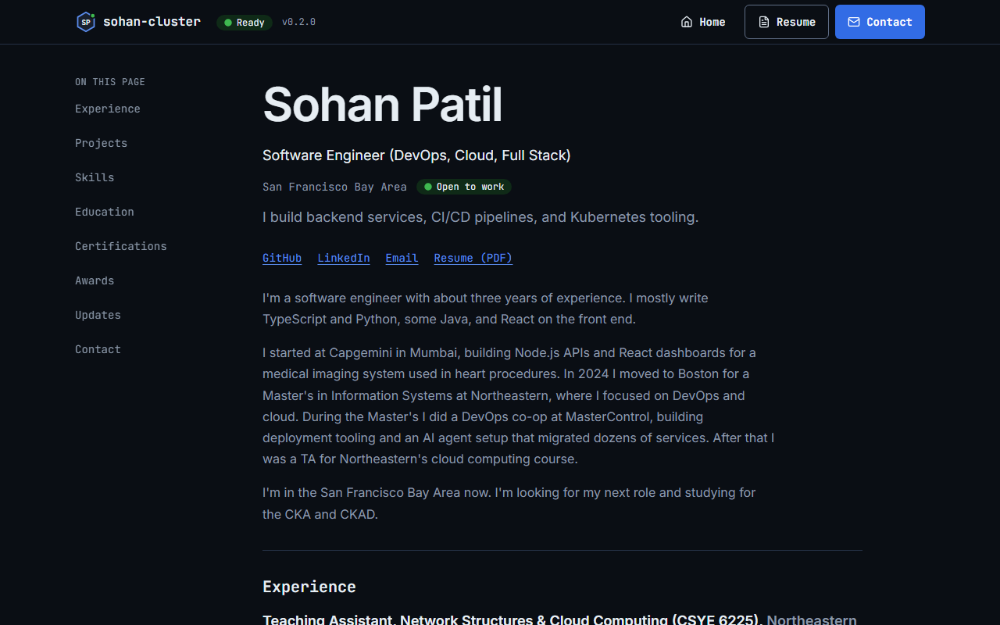
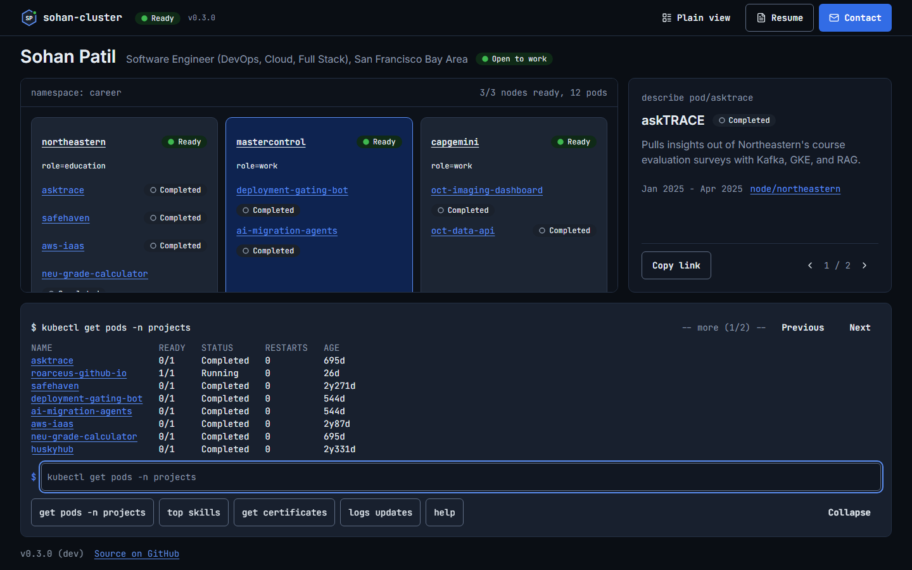
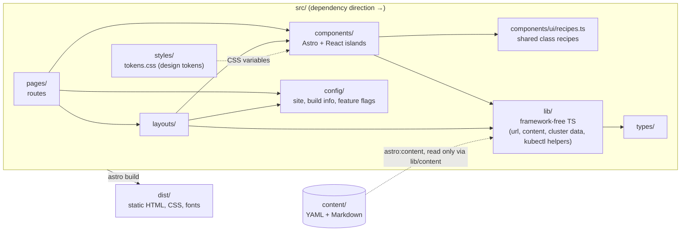
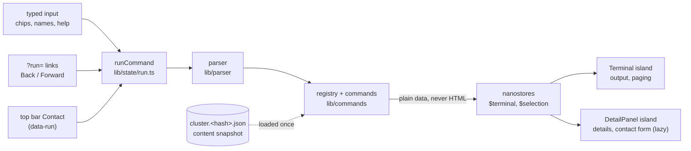
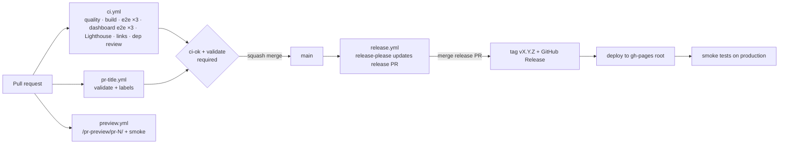

# roarceus.github.io

[](https://github.com/roarceus/roarceus.github.io/actions/workflows/ci.yml)
[](https://scorecard.dev/viewer/?uri=github.com/roarceus/roarceus.github.io)

My portfolio (I'm **Sohan Patil**, a software engineer in DevOps, cloud, and full stack), built as an
interactive Kubernetes cluster: explore with `kubectl`-style commands or a clickable cluster map, or
switch to a plain, recruiter-friendly view.

**Live:** https://roarceus.github.io/



Coming next, already in PR previews behind a flag: the cluster dashboard on `/`.



## Status

**v0.4.0 is live: Stage 3 (terminal engine) is done.** Stage 3 made the
dashboard's terminal real: `kubectl`-style commands with real-looking output, Tab completion, history, and
clickable names and chips that run in place. On desktops at least 1024 by 700 pixels the dashboard fits one
screen and nothing scrolls: long output and long details page like `less`
([ADR 0005](docs/adr/0005-3d-cluster-one-screen.md)). The dashboard stays behind the `clusterDashboard`
flag, on in PR previews and off in production, until the 3D cluster (Stage 4) makes it whole. Direction:
[ADR 0002](docs/adr/0002-design-direction-tool-and-game.md), the UI is the tool, the cluster is the game
([design](docs/plans/stage-3-design.md), [plan](docs/plans/stage-3.md)). Progress:
[`docs/STATUS.md`](docs/STATUS.md) · [project board](https://github.com/users/roarceus/projects/1) ·
[changelog](CHANGELOG.md) (from v0.1.0).

## Features

Planned per stage ([SPEC §11](docs/SPEC.md)):

| Stage                        | Version | What ships                                                                                                    |
| ---------------------------- | ------- | ------------------------------------------------------------------------------------------------------------- |
| 0 — Foundation               | 0.1.0   | Scaffold, quality gates, CI, PR previews, releases, placeholder page                                          |
| 1 — Content and plain view   | 0.2.0   | Schema-validated content, full plain portfolio, project pages, updates + RSS, contact form, SEO, sitemap, 404 |
| 2 — Design system and layout | 0.3.0   | Tokens, components, top bar, shorter plain view, dashboard shell (flagged), mobile cluster mode               |
| 3 — Terminal engine          | 0.4.0   | `kubectl`-style commands, autocomplete, history, clickable output                                             |
| 4 — Cluster visualization    | 0.5.0   | Interactive map of nodes (roles) and pods (projects), synced with the terminal                                |
| 5 — Boot sequence and polish | 0.6.0   | Boot animation, transitions, OG images, tap-first mobile cluster                                              |
| 6 — Game layer               | 0.7.0   | Self-healing pods, chaos mode, badges, easter eggs                                                            |
| 7 — Hardening                | 1.0.0   | Accessibility and performance passes, cross-browser checks, launch                                            |

### The terminal (Stage 3, in previews)

- **Commands:** `get` (nodes, experience, pods, certificates, achievements, events, all; `-o wide`, `-o yaml`,
  `-o name`), `describe node|pod`, `top skills`, `logs updates -f`, `apply -f contact.yaml`,
  `port-forward github|linkedin`, `config use-context plain`, `cluster-info`, `version`, `help`, `clear`.
  Errors read like kubectl's, with a "Did you mean this?" suggestion.
- **Typing:** Tab completes commands, flags, and names; Up and Down walk the history; Ctrl+C and Ctrl+L work.
- **Clicking:** chips, table names, and help entries run in place; without JavaScript they are plain-view links.
- **Detail panel:** follows every `describe`; on phones it is the bottom sheet where output shows.
- **Links:** every view has a shareable `?run=` URL (read-only commands only), and Back and Forward step
  through views.
- **Contact:** `apply -f contact.yaml`, or the top bar Contact button on the dashboard, opens a contact form
  shaped like a YAML manifest in the detail panel.

Everything stays reachable without typing (clickable map, command chips, plain view), works from 320px to
2560px, and respects reduced motion.

## Tech stack

Astro 7 (static output) · React 19 islands · nanostores for shared island state · TypeScript 6 (strict) · Tailwind CSS 4 with CSS-variable
design tokens · self-hosted Inter and JetBrains Mono (Fontsource) · Lucide icons · Vitest 5 · Playwright 1.65 + axe ·
Lighthouse CI · GitHub Pages. Choices and version pins: [ADR-0001](docs/adr/0001-stack-and-tooling.md).

## Architecture



How a command runs (Stage 3): every way in goes through one function, and the islands only read stores.



`lib/` never imports React, Astro, or UI code (enforced by ESLint and dependency-cruiser), so all logic is
unit-testable. The one exception is `lib/content/queries.ts`, the adapter that reads `astro:content`, sorts
entries, and runs the content integrity check; everything it calls is pure. Every internal URL goes through `url()` (`src/lib/utils/url.ts`), written without a
leading slash (`url('plain/')`), so the same build works at `/` and under `/pr-preview/pr-<N>/`; a test
fails on hardcoded root paths.

## Getting started

Requires Node **26.13.1** (`.nvmrc`) and pnpm **12.23.0**. Full guide, including Windows notes:
[`docs/runbooks/local-setup.md`](docs/runbooks/local-setup.md).

```sh
pnpm install    # also installs the git hooks
pnpm dev        # http://localhost:4321
pnpm check      # what CI runs, except e2e
```

Build the way a PR preview does: `BASE_PATH=/pr-preview/pr-0/ pnpm build` (Git Bash needs
`MSYS2_ENV_CONV_EXCL=BASE_PATH` in front; PowerShell: `$env:BASE_PATH='/pr-preview/pr-0/'; pnpm build`).

Unfinished features sit behind build-time flags in `src/config/features.ts`, all off by default and
never turned on for production. Turn one on for a local build with
`PUBLIC_ENABLED_FLAGS=clusterDashboard pnpm build` (PowerShell: `$env:PUBLIC_ENABLED_FLAGS='clusterDashboard'`);
an unknown flag name fails the build.

## Scripts

| Script                                     | What it does                                                                                                                        |
| ------------------------------------------ | ----------------------------------------------------------------------------------------------------------------------------------- |
| `pnpm dev` / `pnpm build` / `pnpm preview` | Dev server / static build into `dist/` / serve `dist/`                                                                              |
| `pnpm typecheck`                           | `astro check` (TypeScript + Astro files)                                                                                            |
| `pnpm lint` / `pnpm lint:fix`              | ESLint: type-aware TypeScript, Astro, React, a11y, import order and cycles                                                          |
| `pnpm format` / `pnpm format:check`        | Prettier (with Astro and Tailwind class sorting)                                                                                    |
| `pnpm knip`                                | Unused files, exports, and dependencies                                                                                             |
| `pnpm depcruise`                           | Dependency direction (`lib/` free of UI code, React, Astro) and no cycles                                                           |
| `pnpm test` / `pnpm test:watch`            | Unit tests (Vitest), including the hardcoded root path check                                                                        |
| `pnpm test:coverage`                       | Unit tests with coverage thresholds (`src/lib` ≥ 90%, overall ≥ 80%)                                                                |
| `pnpm test:e2e`                            | Playwright + axe on the built site; one engine: `--project="chromium-*"`; dashboard specs need a flag build and `--grep @dashboard` |
| `pnpm test:visual`                         | Visual regression (baselines revisited in Stage 7)                                                                                  |
| `pnpm test:smoke`                          | Smoke tests against a deployed URL: `SMOKE_BASE_URL=https://…/ pnpm test:smoke`                                                     |
| `pnpm lhci`                                | Lighthouse CI against `dist/` (home, plain view, a project, updates, 404) with the mobile budgets                                   |
| `pnpm check`                               | Format check, lint, typecheck, knip, depcruise, tests with coverage, build                                                          |

## Project structure

```
.github/        workflows, composite setup action, issue/PR templates, labels, commit convention
.husky/         pre-commit (lint-staged) and commit-msg (commitlint) hooks
docs/           SPEC, STATUS, plans, ADRs, runbooks, postmortems, content guide, concepts (design prototypes)
public/         served as-is: favicon, resume, share image (og-image.png), .nojekyll
src/
  components/   cluster/ (dashboard stage, the detail panel island with Copy link), layout/ (top bar and site mark, footer, bottom sheet, SEO head
                tags), plain/ (plain view sections and jump chips), terminal/ (the terminal island: input, output
                renderer shared with the detail panel, live region), ui/ (button, chip, panel,
                kubectl table, expander, status pill, tags, links; shared class recipes in recipes.ts)
  config/       site metadata, build info (version + commit), feature flags
  content/      portfolio content (YAML + Markdown); schemas registered in content.config.ts
  layouts/      page layouts (BaseLayout sets meta tags; Astro writes the hashed CSP, ADR 0004)
  lib/content/  Zod schemas, query helpers, integrity check, cluster data (nodes, pods, kubectl rows), and the
                terminal's content snapshot (served as cluster.<hash>.json when the dashboard flag is on)
  lib/commands/  terminal commands (registry, get/describe/top/logs/apply and friends, Tab completion, a small
                YAML writer); each returns plain data the terminal renders, never HTML
  lib/parser/   terminal command parser (pure: tokens, flags, kubectl-style errors)
  lib/state/    shared terminal state (nanostores): output, history, selection, the snapshot loader, the one
                run path, and ?run= deep links
  lib/perf/     JavaScript budget math (script graphs from built HTML, limit checks) for check-budgets.mjs
  lib/seo/      share metadata, JSON-LD, and CSP helpers
  lib/utils/    framework-free helpers: url() for the base path, dates, contrast ratios, kubectl ages and names,
                flags, did-you-mean suggestions
  pages/        routes (plus rss.xml, robots.txt, and the 404 page)
  styles/       tokens.css (design tokens, AA-checked by tokens.test.ts; --scene-* only for the cluster
                scene, ADR 0002) and global.css
tests/
  e2e/          Playwright specs (fail on any console error)
  smoke/        post-deploy checks against a live URL
  static/       repo-wide checks (hardcoded root paths, scene tokens only in the cluster and game folders)
  visual/       screenshot baselines (revisited in Stage 7)
```

Target layout for later stages: [SPEC §3](docs/SPEC.md).

## CI/CD



| Workflow        | Runs on             | What it does                                                                                                                                                                                                                                                                                                                                                                                                                                                                                                                                                                                                                                                                                                                                                                                                                                                                                                                                                                       |
| --------------- | ------------------- | ---------------------------------------------------------------------------------------------------------------------------------------------------------------------------------------------------------------------------------------------------------------------------------------------------------------------------------------------------------------------------------------------------------------------------------------------------------------------------------------------------------------------------------------------------------------------------------------------------------------------------------------------------------------------------------------------------------------------------------------------------------------------------------------------------------------------------------------------------------------------------------------------------------------------------------------------------------------------------------- |
| `ci.yml`        | PRs, `main`         | Format, lint, typecheck, knip, dependency rules, unit tests + coverage, `pnpm audit` (high, prod deps), build (also under a preview base path, and a second build with the `clusterDashboard` flag, whose terminal data file must stay under 30 KB gzipped), a CSP audit of every built page (ADR 0004), JavaScript budgets from `.github/budgets.json` (dashboard island code without the shared React runtime, the dashboard startup total, and production page scripts; limits and reasons in the file), Playwright + axe on Chromium, Firefox, and WebKit across desktop, phone, and tablet sizes (the `@dashboard` specs run against the flag build; any CSP violation fails a test), Lighthouse mobile budgets on home, the plain view, a project page, updates, the 404 page, and the dashboard home (perf ≥ 90, a11y/best practices/SEO ≥ 95; the noindex 404 page skips only the indexing audit), offline link check, dependency review. `ci-ok` passes only if all pass. |
| `pr-title.yml`  | PRs                 | PR title is a Conventional Commit with an allowed type and scope, ≤ 72 chars (it becomes the squash commit). Adds `type:` and `area:` labels.                                                                                                                                                                                                                                                                                                                                                                                                                                                                                                                                                                                                                                                                                                                                                                                                                                      |
| `preview.yml`   | PRs                 | Builds under `/pr-preview/pr-<N>/` with unfinished features on (`PUBLIC_ENABLED_FLAGS=clusterDashboard`), deploys to `gh-pages`, comments the URL, smoke-tests it, removes it on close.                                                                                                                                                                                                                                                                                                                                                                                                                                                                                                                                                                                                                                                                                                                                                                                            |
| `release.yml`   | `main`, manual      | release-please (GitHub App token) keeps a release PR open; merging it tags, deploys production, and smoke-tests it. Manual run with a tag = rollback.                                                                                                                                                                                                                                                                                                                                                                                                                                                                                                                                                                                                                                                                                                                                                                                                                              |
| `codeql.yml`    | PRs, `main`, weekly | CodeQL security and quality queries (JavaScript/TypeScript).                                                                                                                                                                                                                                                                                                                                                                                                                                                                                                                                                                                                                                                                                                                                                                                                                                                                                                                       |
| `scorecard.yml` | `main`, weekly      | OpenSSF Scorecard supply-chain checks (Security tab and badge).                                                                                                                                                                                                                                                                                                                                                                                                                                                                                                                                                                                                                                                                                                                                                                                                                                                                                                                    |
| `scheduled.yml` | weekly, quarterly   | Smoke tests, external links, and Lighthouse against production; a failure opens one `ops` issue that closes itself on recovery. Quarterly content-review issue.                                                                                                                                                                                                                                                                                                                                                                                                                                                                                                                                                                                                                                                                                                                                                                                                                    |
| `labels.yml`    | `main`, manual      | Syncs labels from `.github/labels.yml`.                                                                                                                                                                                                                                                                                                                                                                                                                                                                                                                                                                                                                                                                                                                                                                                                                                                                                                                                            |

Required status checks on `main`: **`ci-ok`** and **`validate`**. All actions are pinned to commit SHAs
and every job declares least-privilege permissions.

**Releases:** feature PRs merge to `main`; release-please keeps a `chore(release): release x.y.z` PR with
the version bump and changelog; merging it deploys. Pre-1.0, each stage is a minor release. Runbooks:
[releasing](docs/runbooks/releasing.md) · [rolling back](docs/runbooks/rolling-back.md) ·
[hotfixing](docs/runbooks/hotfixing.md).

**Dependencies:** Renovate opens grouped, pinned update PRs on Monday mornings; only devDependency patches
merge themselves (after CI passes). Node majors are manual (LTS). Security fixes open right away.

## Manual setup (done once, in GitHub)

These can't be automated from the repo; all are done for this repo.

1. Actions → General: read-only `GITHUB_TOKEN`; require actions pinned to full commit SHAs; leave "Allow
   GitHub Actions to create and approve pull requests" off.
2. Advanced Security: secret scanning + push protection, Dependabot alerts, private vulnerability
   reporting; CodeQL default setup off (`codeql.yml` replaces it).
3. GitHub App for release-please (Contents, Pull requests, Issues: read/write; this repo only) →
   variable `RELEASE_APP_ID`, secret `RELEASE_APP_PRIVATE_KEY`.
4. Rulesets: `protect-main` (PRs, squash only, linear history, no force push or deletion, required checks
   `ci-ok` and `validate`) and `protect-release-tags` (`v*` can't be updated or deleted). Exports:
   [`docs/github/rulesets/`](docs/github/rulesets/).
5. Pages: deploy from branch `gh-pages`, `/ (root)`. Environment `github-pages` allows `main` and `gh-pages`.
6. Renovate GitHub App installed on this repo only.
7. Still to do: uptime monitor for https://roarceus.github.io/ (after v0.1.0); Web3Forms and GoatCounter
   keys and `public/resume.pdf` (Stage 1).

## Contributing

See [`CONTRIBUTING.md`](CONTRIBUTING.md) (branches, Conventional Commits, PR process) and
[`SECURITY.md`](SECURITY.md) for reporting vulnerabilities. Working rules for AI-assisted changes:
[`CLAUDE.md`](CLAUDE.md).

## License

Code is [MIT](LICENSE). Site content (text, images, and the resume) is copyright Sohan Patil, all rights
reserved.
